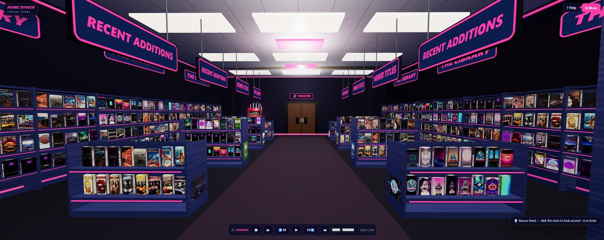
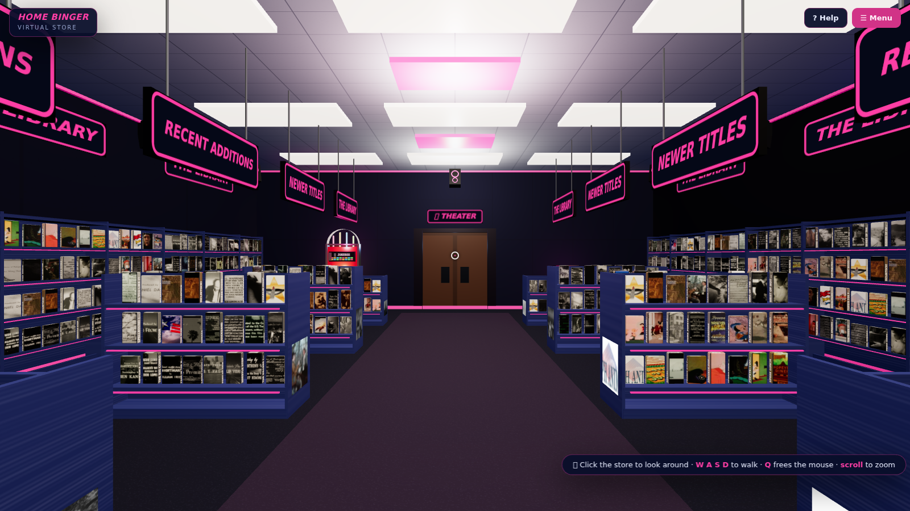
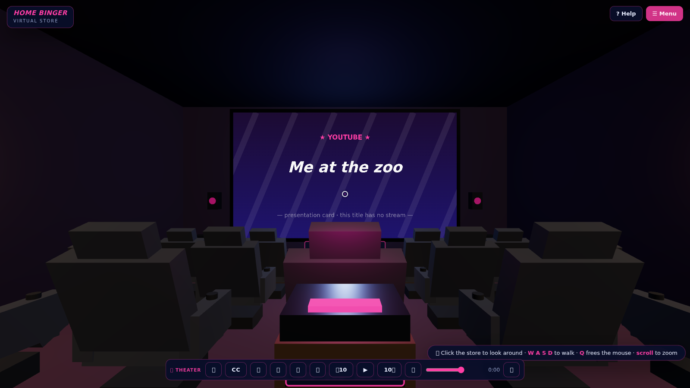
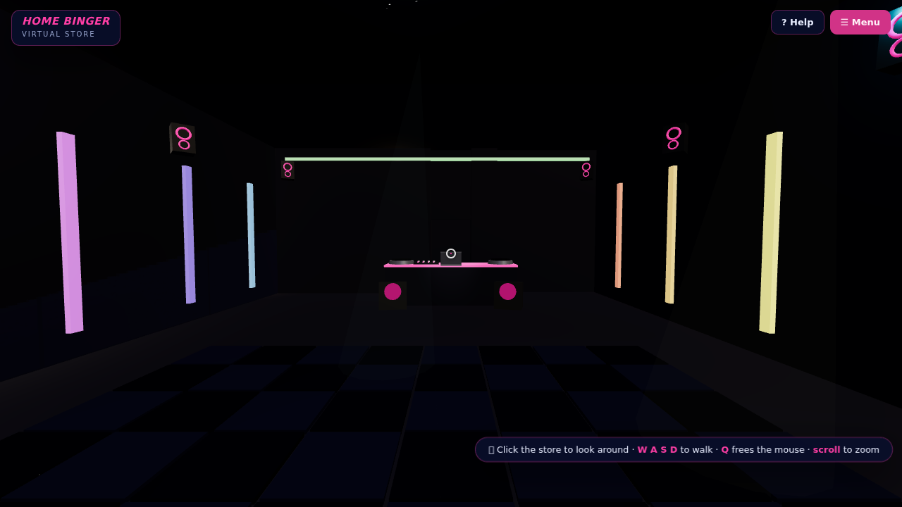
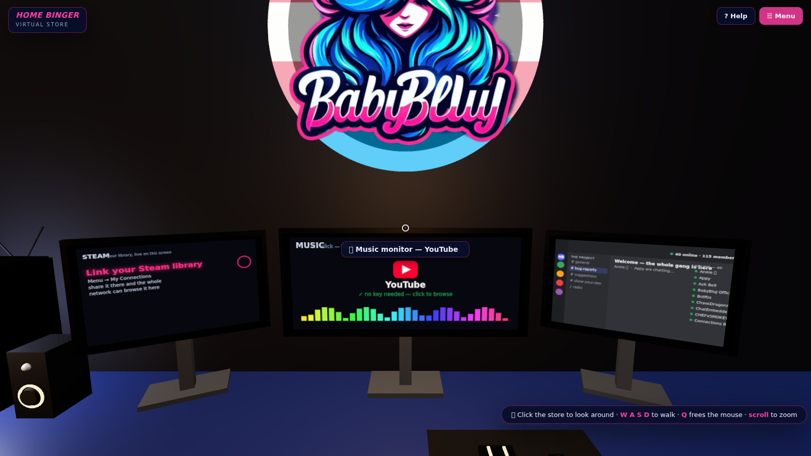
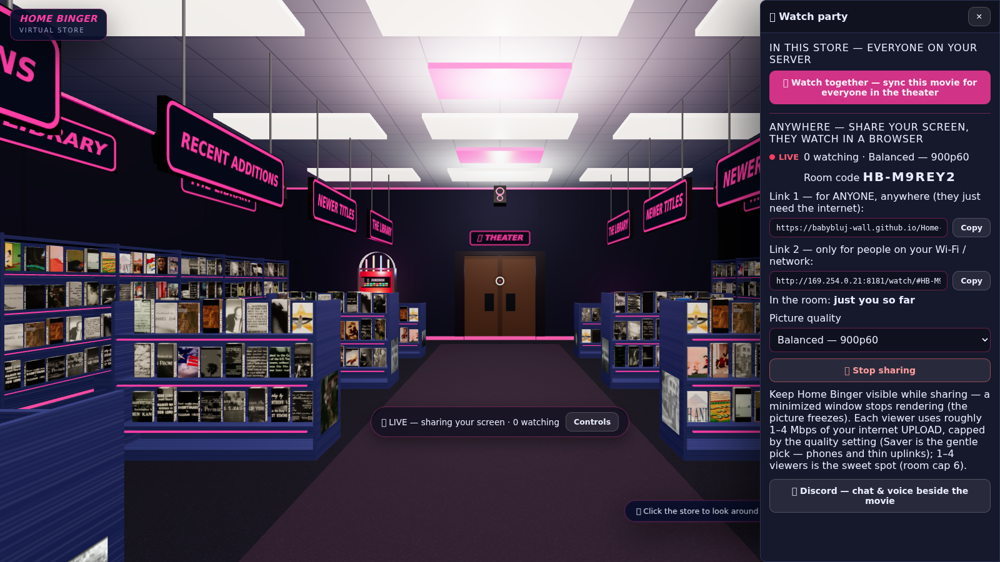
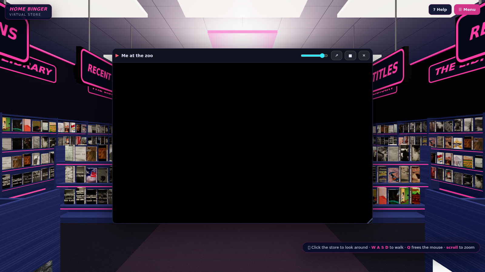
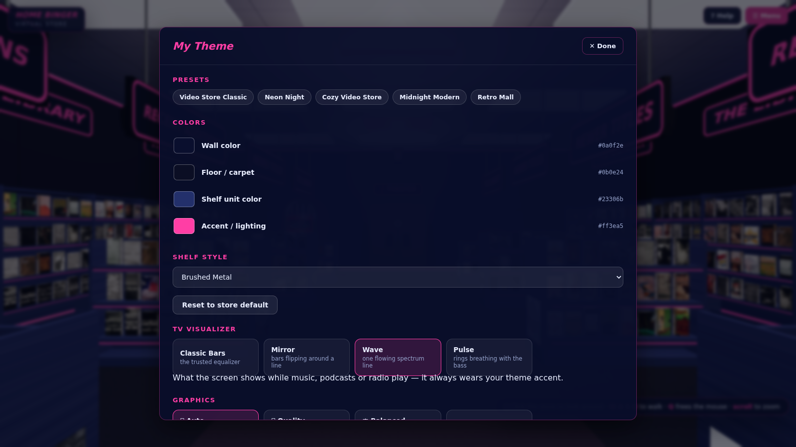

# 📼 Home Binger™

<p align="center">
  
</p>

<p align="center"><b>The 3D Storefront for The CordCut Co-op™ (TCC™)</b><br>
A self-hosted, walkable 3D video store stocked from your own <b>Plex</b>, <b>Jellyfin</b>, or any folder on your server — with a private movie theater, a neon dance hall, a game room, and <b>watch parties anyone can join from a plain browser link</b>.</p>

<p align="center">
  <a href="https://github.com/BabyBluJ-wall/Home-Binger/releases"></a>
  <a href="LICENSE"></a>
  
  <a href="https://discord.gg/pB4HKjQGaX"></a>
</p>

Free for anyone to use and modify, **not for sale** — licensed under [CC BY-NC-SA 4.0](LICENSE). Made with 💙 by **BluJ Productions** — owner-directed, owner-designed, ear-tested by BluJ; engineered with AI assistance by [Arena.ai](https://arena.ai)'s Agent Mode (full story in [`docs/CREDITS.md`](docs/CREDITS.md)).

---

## 🏬 What's inside

Four connected spaces under one roof:

- **🏬 The store** — a classic video-rental floor: gondola islands, hanging category signs, and cases shoulder-to-shoulder in real **VHS / DVD / CD** sizes, wrapped in **your actual cover art** (pulled by metadata ID from Plex/Jellyfin, not a name search). The **jukebox** against the back wall opens a DJ deck — queue, fades, EQ, tempo — and the store TV plays anything you pick off a shelf.

  <p align="center"></p>

- **🎬 The theater** — a sloped-floor screening room with its own big screen and an **8.2 array** (discrete 7.1 on multichannel hardware, HRTF binaural in a headset). Bring a movie from any shelf, go **full screen at native resolution**, and press **G** for the **TV Guide** — thousands of officially-free live channels, docked beside the movie.

  <p align="center"></p>

- **🪩 The dance hall** — a glossy checkerboard floor that **pulses with the music**, a mirror ball, light rigs that land ON the beat (an adaptive beat detector learns each track), and a full **DJ booth** — two decks, crossfader, hot cues, loops, BPM + key detection. Room-gated sound: the music never bleeds into the store or theater.

  <p align="center"></p>

- **🎮 The game room (the den)** — a battle station behind the rising neon pocket door: glass showcase tower (hue-cycling fans, glowing water block), RGB keyboard and mouse, and **three monitors that actually work** — the **Discord portal**, the **music station** (YouTube, keyless), and your **Steam library**. The store's glow-lit logo hangs above; the big neon **angel-demon sign** fills the store-side wall.

  <p align="center"></p>

**Controls:**

| Key | What it does |
|---|---|
| **W A S D** | walk (arrow keys work too) |
| **Mouse** | look around (click the store first) · **Q** frees / re-grabs it |
| **Scroll** | zoom — lean into a shelf of covers |
| **☰** (top-right) | menu — sorting, themes, sign-in, admin |
| **G** | TV Guide (theater) · **F** full screen · **/** instant search |

---

## 👀 Watch together — three ways

- **In the theater (everyone on your server):** the host clicks **Watch together** and the room follows — gentle drift correction, and the group pauses while someone buffers (a guest whose connection keeps struggling stops holding the room hostage after a few pauses: the party plays on and they catch up when it steadies).
- **Anywhere (any browser, no install):** **🌐 Share this Home Binger — live** hands you a link and a six-character room code. Friends open it on a phone or laptop, type a name, and watch your screen live with your system's sound — WebRTC with STUN + a free relay fallback, so home routers and cellular work without a VPN. Up to six viewers, four quality tiers — Saver 720p30 up to **Ultra 1440p60**, each bitrate-capped (2–20 Mbps) so it can't overdrive a thin uplink — and honest live stats on their end. If a chat app mangles the link, they just type the code.
- **App-to-app:** friends running their own Home Binger sync theater screens directly, peer-to-peer.

<p align="center"></p>

## 🎛 The panels

- **The player panel** — **YouTube itself, docked beside you**: browse the real site, click a video, and (in the desktop app) it plays through the official embed player — **keyless, mostly ad-free** (fewer ads, not zero: the embed lane plus the app's blocker stops most, but a few ride the video's own pipes where no blocker can reach). The remote's ⏯ and volume drive it; music in the den stays in the den through its own 2.1 rig.

  <p align="center"></p>

- **Settings → My Theme** — theme presets and colors, the **graphics dial** (Auto watches your frame rate and steps render resolution to fit the machine), and a **photosensitive comfort switch** that calms every flashing effect.

  <p align="center"></p>

---

## ✨ What's new

- **🎮 The game room** — the battle station, the glass tower, three working monitors, the angel-demon sign.
- **🎵 The music station** — YouTube in the player panel, keyless; Steam library sharing server-wide (one key, Test buttons that say exactly what's wrong).
- **👀 Watch with me** — theater sync, live browser shares (quality caps, a self-smoothing guest player, share links that work for anyone — no VPN), app-to-app sync.
- **📺 The big screen** — YouTube links and playlists play ON the screen; full-screen Guide docking; CC on the theater remote.
- **⚙️ Comfort** — panels free the mouse; the Guide can't stall; the graphics dial; the photosensitive switch.
- **🐛 Fixed** — desktop mouse capture (b27), the YouTube "Error 153" embed break (b28), buffering on real networks (b30), share links that only worked over a VPN (b31).

Full history: [`CHANGELOG.md`](CHANGELOG.md)

---

## 🚀 Quick start

**Windows exe (nothing to install):** grab the newest **HomeBinger….zip** from the [Releases page](https://github.com/BabyBluJ-wall/Home-Binger/releases), unzip, double-click **HomeBinger.exe**. Node.js is **not** required; a **1 - START HERE** file in the folder walks you through it. (First run: SmartScreen → *More info → Run anyway* — the exe is unsigned.)

**Node.js:** unzip the source and run:
```
node server/server.js        # → http://localhost:8181
```
**Docker:**
```
docker compose up -d         # → http://<machine>:8181
```

**Stock it (2 minutes):** ☰ Menu → 🛠️ Admin sign-in (**BabyBluJ / BluJNetwork** — the default, change it) → Admin → Server → **Plex** (URL `http://<ip>:32400`; token from Plex Web → any movie → ⋯ → Get Info → View XML) or **Jellyfin** (`:8096`; key from Dashboard → API Keys) → **Test connection** → **Save & stock the shelves**. No media server? Point **📁 Local files** at any folder — everything inside gets shelved, and videos grow their own case art automatically.

**Invite the house:** anyone on your Wi-Fi opens `http://<your-PC-ip>:8181` in any browser — nothing to install (phones get a clean list view with the 3D store one tap away). Allow Home Binger through **Windows Firewall** when asked.

**Updating** = unzip the new folder and open the new exe — accounts and settings migrate themselves; the old folder gets renamed "(old — you can delete this)". **Uninstalling** = delete the folder. Nothing lands in the registry or Program Files.

### Sources (stack as many as you like)

| Source | What you get |
|---|---|
| **Plex / Jellyfin** | your full library, paginated to the last page — movies & TV on the shelves, music on the jukebox, Live TV/DVR as 📺 VHS tapes |
| **➕ More libraries** | extra Plex/Jellyfin servers (yours, or a friend's), each with its own switch and Test button |
| **📁 Local files** | any folders, recursive; music grouped by album; auto case art; ebooks indexed |
| **🎞️ Internet Archive** | public-domain classics, free and legal |
| **📻 Radio-Browser** | live radio stations on the jukebox |
| **🎙️ Podcasts** | any podcast by RSS feed |

Movies shelve as VHS sleeves and DVD cases, TV as per-episode DVD sets grouped by series, music as CD jewels by album, live TV as tapes. Any library can be **scoped per account** — cartoons for the kids' logins, grown-up shelves for the parents.

---

## 📺 Screens & sound

- **The store TV** — play any case right in the world; albums get a spectrum visualizer; the idle screen is admin-settable (standby card, pinned item, video URL, or projector white).
- **The TV Guide** (**G** in the theater) — numbered channels with logos, **NOW & NEXT** program data where providers publish schedules, a time bar up to eight hours ahead (**T**), genre pages, a provider row, ☆ favorites, instant search (**/**), duplicates removed automatically, 60fps virtualized even at 1,400+ channels. In full screen it **docks beside the movie** — flip channels like a second monitor. Stock it from the free directory or one-click packs: **Pluto TV, Samsung TV Plus, Tubi, The Roku Channel, Plex Free**, whole countries, or any `.m3u` URL.
- **Jukebox + DJ booth** — two devices, each with a full deck (the booth's **PRO rig**: two decks, per-deck EQ/trim/tempo/key-lock, hot cues, beat-snapped loops, BPM + Camelot key detection, session save/load). The whole dance hall answers the music — floor, beams, LED walls.
- **The sound engine** — Google's **Resonance Audio** Ambisonic rendering, bass management at ~100 Hz, cinema voicing, protection limiters, gliding volume; every room gain-staged to the same reference (`docs/AUDIO.md`, `docs/SURROUND.md`).

## 🧑‍🤝‍🧑 Users & personalization

- **No login needed** — every visitor gets an automatic device profile; theme and shelf arrangement persist on that browser.
- **Optional accounts** carry preferences across devices; **admins** manage sources, the store TV, users, and store-wide policies.
- **Invite a friend** — a one-time key links their Home Binger to your shelves over the internet, gated to exactly what you shared (`docs/FRIEND-SHARING.md`).
- **Personalize** — wall/floor/shelf/accent colors, shelf styles (warm wood / brushed metal / midnight laminate), presets, projector-screen look; sort by Recently Added · Library · Genre (with hanging signs) · A–Z · Rating · Year · Type.

## 💻 Will it run on my machine?

| | Minimum | Comfortable |
|---|---|---|
| **OS** | Windows 10 64-bit | Windows 10/11 64-bit |
| **CPU** | dual-core, ~2015+ | quad-core+ |
| **RAM** | 4 GB | 8 GB |
| **GPU** | any GPU with working drivers (DX11 era) | Intel HD 530+ or dedicated |
| **Disk** | ~1 GB free (the app unpacks to ~330 MB) | — |
| **Internet** | not required — local media + the file grabber work fully offline | needed for the free live TV/radio shelves, the music station, watch parties |

Measured, not guessed: the whole 3D app draws about **0.4–0.6 GB of memory** (store idle → game room with panels open), even with software rendering — a 4 GB machine runs it, and 8 GB makes everything roomy. Three honest notes: **GPU drivers matter more than GPU power** (broken drivers fall back to software rendering — it works, but the start screen can take 30–60 s), the heaviest moments are the DJ booth and high-bitrate video, and the **Settings → Graphics dial** on Auto steps the render resolution down on weaker machines all by itself.

**Hosting a watch party** is the one genuinely demanding job: your PC captures and encodes its screen while running the store. Any GPU with hardware video encoding (Intel HD 530+ / 6th-gen and up, or any dedicated card) shrugs at it; a 2015 dual-core without that will want **Saver** quality (720p30). Budget **~2–20 Mbps of upload per viewer** depending on the tier (Saver ≈ 2 · Balanced ≈ 6 · High ≈ 12 · Ultra ≈ 20). Watching as a guest works on anything that plays YouTube.

Node/browser mode: the same table, but the browser carries the graphics — any current Chrome, Edge, or Firefox with WebGL2. Port **8181** (the exe politely takes 8182+ if it's busy).

## ⚙️ For self-hosters

- **Environment variables** (first-run seeds only — after that, `data/config.json`): `PORT` · `HOST` · `HB_ADMIN_USER` · `HB_ADMIN_PASSWORD` · `HB_DATA_DIR` · `HB_SESSION_SECRET` · `HB_SOURCE` (`plex`/`jellyfin`) · `HB_PLEX_URL`/`HB_PLEX_TOKEN` · `HB_JELLYFIN_URL`/`HB_JELLYFIN_API_KEY`.
- **Remote access** — binds `0.0.0.0`, so LAN and VPN just work. For the public internet, put HTTPS in front (Caddy/nginx examples in `docs/REMOTE-ACCESS.md`) and never expose the raw port.
- **Security** — Plex/Jellyfin tokens never reach the browser (server-side proxy + poster cache), scrypt password hashing, HttpOnly sessions. Still a hobby app: keep it behind HTTPS and change the admin password.

## 🗂️ Project tour

```
home-binger/
├── server/                    the backend (plain Node, ZERO npm deps)
│   ├── server.js              entry point — HTTP + static files
│   ├── lib/                   auth · store · library · proxy · party · friends
│   └── lib/adapters/          plex · jellyfin · local · archive · radio · podcasts
├── public/                    the frontend (three.js, no build step)
│   ├── index.html · css/      page shell + UI styling
│   ├── js/main.js · ui.js     boot · panels, modals, sidebar
│   ├── js/party.js            theater watch-party sync
│   ├── js/wwremote.js         live screen-share rooms (the anyone link)
│   ├── watch/                 the browser guest page (self-contained)
│   └── js/store3d/            rooms · shelves · jukebox · config.js (every knob)
├── desktop/main.cjs           the Electron shell — HomeBinger.exe's window
├── tools/build-desktop.mjs    builds the Windows exe folder from source
├── tests/v35.cjs              the self-check suite (193 checks, headless)
├── docs/                      AUDIO · SURROUND · EDITING · CREDITS · RELEASE · …
├── Dockerfile / docker-compose.yml
└── START-HERE.txt             plain-language guide (ships in the zip)
```

Want a bigger room, more islands, chunkier cases? Open **`public/js/store3d/config.js`** — every number is labeled and reloads with the page (`docs/EDITING.md`).

## 🩺 Troubleshooting

| Problem | Fix |
|---|---|
| `'node' is not recognized` | install the LTS from nodejs.org, then reopen the terminal |
| Shelves show placeholders forever | media server unreachable from this machine — check URL/token in Admin → Server (in Docker: `host.docker.internal`) |
| Other devices can't connect | Windows Firewall → **Allow** (Private); use the PC's IP (`ipconfig`), not `localhost` |
| HomeBinger.exe won't open | SmartScreen → *More info → Run anyway*; antivirus quarantine is the other suspect |
| Which port? | 8181, or the next free one up — try `http://<pc-ip>:8181` first |
| Pointer lock won't engage | click the store once (embedded previews fall back to click-drag looking) |
| Watch-together link won't load | use the **anyone** link (Link 1); Link 2 only works on your own network — and the panel warns you if the guest page isn't published yet |
| Port already in use | `PORT=9090 node server/server.js` |

## ⚖️ License & trademarks

**Home Binger is free for personal, non-commercial use** under [CC BY-NC-SA 4.0](LICENSE): run it freely at home, customize anything, share copies — no selling it or charging for access, and shared builds carry the same license with credit to BluJ Productions. Bundled open-source components (three.js, Resonance Audio, Electron, Node.js) are listed with their licenses in [`docs/CREDITS.md`](docs/CREDITS.md).

**Home Binger™, The CordCut Co-op™, TCC™, the logos, and BluJ Productions are trademarks of BluJ Productions.** The license covers code and assets, not the names: forks and distributions must rebrand under their own name and logo. Full policy: [`TRADEMARKS.md`](TRADEMARKS.md).

Like the project? The door inside the store copies the support link. 💛

---

**The CordCut Co-op™ · TCC™ · Home Binger™**
© 2026 BluJ Productions. All rights reserved.
*Software licensed under CC BY-NC-SA 4.0. Brand names and logos are trademarks of BluJ Productions.*
